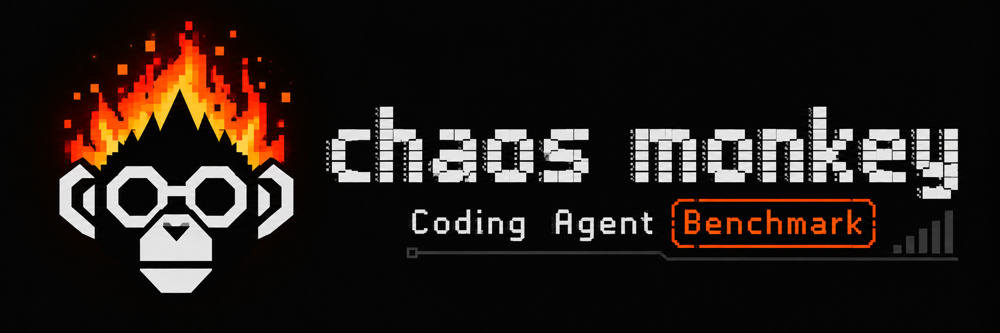

<p align="center">
  
</p>

# Chaos Monkey for Coding Agents

How coding-agent harnesses recover when their tools fail. A fault-injection benchmark.

CMCA injects seeded faults into tool calls at two layers: an MCP proxy in front of mock services (Track S) and each harness's own built-in tools (Track N). It measures task success under faults, recovery behavior, the cost of recovery, and whether the agent reports its outcome honestly. The full design is in [SPEC.md](SPEC.md).

Results and build log: [chaos-monkey-coding-agents.vercel.app](https://chaos-monkey-coding-agents.vercel.app) (source in `packages/site`).

## Status

M0 (foundations) is implemented and M1 (conformance and fixed-model injectors) is in progress. Native injectors for Claude Code, Pi and OpenCode pass conformance; their capability files are in `capabilities/`. Track N has 3 pilot tasks in `datasets/cmca-n`. Smoke and clean pilot runs with `cc-claude` are in `results/`; no leaderboard results are published yet. Track S does not exist yet. Decisions taken during implementation are in [DECISIONS.md](DECISIONS.md); open verification items are in [docs/verification](docs/verification).

## Development

Requirements: Node 24 (22.12 or later works locally), pnpm 10, uv.

```bash
pnpm install
pnpm build
pnpm test
pnpm lint
pnpm bench:decide
uv sync --all-packages
uv run pytest
```

Layout:

| Path | Contents |
|---|---|
| `packages/fault-engine` | Fault schedule, trial state store, catalog, schemas, `tt-decide` CLI |
| `packages/injector-claude-code`, `injector-pi`, `injector-opencode` | Native injectors for Track N |
| `packages/cli` | `cmca` CLI (`lint` today) |
| `packages/site` | Results site (Next.js static export for Vercel) |
| `python/cmca_harbor` | Harbor custom agents, conformance runner, trial planner |
| `python/cmca_analysis` | Analysis pipeline (event log validation and trial summaries today) |
| `profiles/` | Fault profiles |
| `configs/` | Harness configurations |
| `datasets/` | Task datasets, conformance probes and the canary |
| `capabilities/` | Capability files generated from conformance |
| `results/` | Conformance, task validation, smoke and pilot evidence |
| `docs/verification/` | Evidence for third-party behavior (V-01 to V-21) |

## Affiliations

To be completed by the maintainers before the first public release (SPEC 13.2).

## License

Code: Apache-2.0 ([LICENSE](LICENSE)). Task data: CC BY 4.0 ([LICENSE-DATA](LICENSE-DATA)); task files carry a canary string and must not be used for model training.
