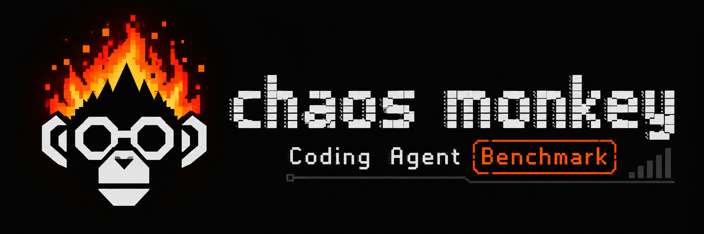

<p align="center">
  
</p>

# Chaos Monkey for Coding Agents

[](https://github.com/davila7/chaos-monkey-coding-agents/actions/workflows/ci.yml)
[](https://github.com/davila7/chaos-monkey-coding-agents/actions/workflows/paper.yml)
[](LICENSE)
[](LICENSE-DATA)
[](https://doi.org/10.5281/zenodo.24403111)
[](https://doi.org/10.5281/zenodo.24378462)
[](https://huggingface.co/datasets/davila7/chaos-monkey-coding-agents)

How coding-agent harnesses recover when their tools fail. A fault-injection benchmark.

CMCA injects seeded faults into tool calls at two layers: an MCP proxy in front of mock services (Track S) and each harness's own built-in tools (Track N). It measures task success under faults, recovery behavior, the cost of recovery, and whether the agent reports its outcome honestly. The full design is in [SPEC.md](SPEC.md) and the method in [METHODOLOGY.md](METHODOLOGY.md).

Paper: [doi.org/10.5281/zenodo.24403111](https://doi.org/10.5281/zenodo.24403111) (preprint on Zenodo). Results site: [www.chaos-monkey.tech](https://www.chaos-monkey.tech) (source in `packages/site`). Data: [Hugging Face](https://huggingface.co/datasets/davila7/chaos-monkey-coding-agents).

## Results

Current release: M6, tag `m6-2026-11-18`, data in [results/2026-11-18-m6](results/2026-11-18-m6), report [reports/2026-11-18-m6-release.md](reports/2026-11-18-m6-release.md). 3,011 trials, 37 Track S and 36 Track N tasks. Every config uses `claude-sonnet-5-5` with reasoning effort `medium`.

Tasks completed under the `moderate` fault profile (37 or 36 tasks x 3 attempts sent per config):

| Track S (MCP services) | Completed | Faulted Success |
|---|---|---|
| fx 0.0.13 | 83 / 111 | 74.8% |
| Pi 1.0.3 | 77 / 111 | 69.4% |
| Codex 0.163.0 | 75 / 111 | 67.6% |
| OpenCode 1.18.35 | 73 / 111 | 65.8% |
| Claude Code 2.1.289 | 69 / 111 | 62.2% |

| Track N (built-in tools) | Completed | Faulted Success |
|---|---|---|
| fxh 0.0.13-h1 | 95 / 108 | 88.0% |
| Codex 0.163.0 | 92 / 108 | 85.2% |
| OpenCode 1.18.35 | 90 / 108 | 83.3% |
| Pi 1.0.3 | 89 / 108 | 82.4% |
| Claude Code 2.1.289 | 87 / 107 | 81.5% |

fx leads Track S and fxh leads Track N. fxh is a fork of fx with tool hooks ([davila7/fxh](https://github.com/davila7/fxh), D-0040), because fx 0.0.13 cannot intercept its built-in tools ([V-22](docs/verification/V-22.md)). Claude Code on Track N counts 107 units: one unit has no counted trial (report section 3). Intervals, degradation curves, retention, overclaim and cost per success are in the report and on the site. Earlier releases stay in `results/2026-10-20-m5` and `results/2026-10-31-m5-codex`.

## Quickstart

Requirements: Docker, Node 24 (22.12 or later works), pnpm 10, uv. No API key: the `oracle` agent runs the reference solution and `nop` does nothing, so a task is valid when the oracle scores 1 and `nop` scores 0.

```bash
git clone https://github.com/davila7/chaos-monkey-coding-agents && cd chaos-monkey-coding-agents
pnpm install --frozen-lockfile && pnpm build
uv sync --all-packages --locked

# Track N: one task, oracle and nop
uv run python -m cmca_harbor.validate --dataset datasets/cmca-n --task n-access-rules --out jobs/quickstart-n

# Track S: build the gateway and mock service images, then the oracle under every fault profile
scripts/service-images.sh
uv run python -m cmca_harbor.validate --dataset datasets/cmca-s --task s-followups --out jobs/quickstart-s
```

Each run writes `summary.json` with the reward per job. Runs with a model need a key and an approved cost estimate (SPEC 20).

## Reproducing the release

The boards are computed from committed trial evidence, with no model calls. From `python/cmca_analysis`, the command in section 1 of the [release report](reports/2026-11-18-m6-release.md) rebuilds `results/2026-11-18-m6`; the analysis is deterministic for the same evidence and seed (SPEC 9.7). Trial directories, including trajectories and injector event logs, are under `results/pilot/`.

## Contributing

[CONTRIBUTING.md](CONTRIBUTING.md) covers checks, task versions, adding a harness and task bugs. Security and safety findings go through [SECURITY.md](SECURITY.md). Conduct: [CODE_OF_CONDUCT.md](CODE_OF_CONDUCT.md). Decisions are in [DECISIONS.md](DECISIONS.md), releases and errata in [CHANGELOG.md](CHANGELOG.md), and verification evidence for third-party behavior in [docs/verification](docs/verification). The task datasheet is [DATASHEET.md](DATASHEET.md).

## Development

```bash
pnpm install
pnpm build
pnpm test
pnpm lint
pnpm bench:decide
uv sync --all-packages
uv run pytest
```

Layout:

| Path | Contents |
|---|---|
| `packages/fault-engine` | Fault schedule, trial state store, catalog, schemas, `tt-decide` CLI |
| `packages/injector-claude-code`, `injector-codex`, `injector-fxh`, `injector-opencode`, `injector-pi`, `injector-muse` | Native injectors for Track N |
| `packages/responses-bridge` | Responses API to Messages API bridge for Codex on Claude (D-0044) |
| `packages/mcp-fault-proxy`, `packages/mock-services` | Track S fault proxy and mock services |
| `packages/cli` | `cmca` CLI (`lint`, `task-bump`, `analyze`) |
| `packages/site` | Results site (Next.js static export for Vercel) |
| `python/cmca_harbor` | Harbor custom agents, conformance runner, trial planner |
| `python/cmca_analysis` | Analysis pipeline: delivery reconciliation, metrics, bootstrap intervals, boards |
| `profiles/` | Fault profiles |
| `configs/` | Harness configurations |
| `datasets/` | Task datasets, conformance probes and the canary |
| `capabilities/` | Capability files generated from conformance |
| `results/` | Conformance, task validation, calibration, smoke, pilot and release evidence |
| `reports/` | Run reports |
| `docs/verification/` | Evidence for third-party behavior |

## Citation

Cite the paper ([CITATION.cff](CITATION.cff) sets it as the preferred citation, which GitHub shows under "Cite this repository"):

```bibtex
@misc{avila_arias_cmca_paper_2026,
  author    = {\'{A}vila Arias, Daniel},
  title     = {Chaos Monkey for Coding Agents: Measuring How Coding-Agent Harnesses Recover When Their Tools Fail},
  year      = {2026},
  publisher = {Zenodo},
  note      = {Preprint},
  doi       = {10.5281/zenodo.24403111},
  url       = {https://doi.org/10.5281/zenodo.24403111}
}
```

To cite the software release:

```bibtex
@software{avila_arias_cmca_2026,
  author  = {\'{A}vila Arias, Daniel},
  title   = {Chaos Monkey for Coding Agents},
  year    = {2026},
  version = {m6-2026-11-18},
  doi     = {10.5281/zenodo.24378462},
  url     = {https://github.com/davila7/chaos-monkey-coding-agents}
}
```

## Affiliations

Daniel Ávila Arias, Independent Researcher.

## License

Code: Apache-2.0 ([LICENSE](LICENSE)). Task data: CC BY 4.0 ([LICENSE-DATA](LICENSE-DATA)); task files carry a canary string and must not be used for model training.
