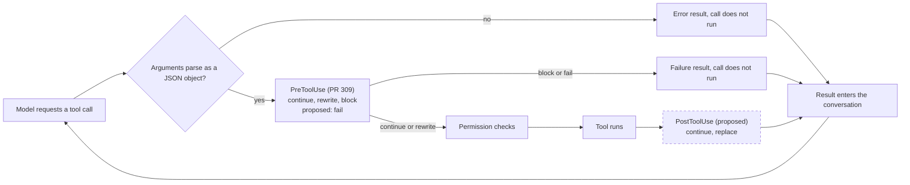

<!-- Draft issue for vercel-labs/fx (D-0049). Title: Let a hook replace a tool result before the model sees it -->

## Summary

[Chaos Monkey for Coding Agents](https://github.com/davila7/chaos-monkey-coding-agents) is an open benchmark that measures how coding agents behave when their tools fail. It makes a tool call fail, return an empty or truncated result, return stale content, or report an error for a call that worked. Then it checks whether the agent still completes the task and reports what happened. To do that with an agent's built-in tools, the benchmark needs two points in the tool loop: one before a call runs, where it can refuse the call, and one after the call runs, where it can replace the result the model sees.

fx 0.0.13 doesn't expose either point to users, so we could test fx only on the benchmark track that injects failures at an MCP server ([V-22](https://github.com/davila7/chaos-monkey-coding-agents/blob/main/docs/verification/V-22.md)). `main` at ca2aa95 has no user setting for tool hooks either. libfx `hooks` report events without changing them, and the libfx native backend doesn't turn on fx's built-in tools, so libfx doesn't cover the CLI agent we test.

#309 exposes `PreToolUse` in user settings, which covers the first point. We're asking for two additions on top of it: a `PostToolUse` event that can replace a tool result and mark it as failed, and a `PreToolUse` response that fails a call without the retry guidance that `block` adds.

## Tool call path with both events



The dashed node is the proposed `PostToolUse` event. `PreToolUse` runs in-process today, and #309 makes it configurable from user settings.

## What we tested in a fork

To measure fx on built-in tools anyway, we forked fx 0.0.13 as [fxh](https://github.com/davila7/fxh/blob/cmca/v0.0.13/FORK.md) and added command hooks at both points ([diff](https://github.com/davila7/fxh/pull/1)). fxh keeps fx's system prompt, tool names, tool descriptions, and error texts. It reuses the runtime in `src/core/hooks`, adds a `PostToolUse` kind and a `fail` action for `PreToolUse`, and dispatches `PostToolUse` after sequential and parallel tool calls.

We ran fxh in a container against a stub model, with no model calls ([V-27](https://github.com/davila7/chaos-monkey-coding-agents/blob/main/docs/verification/V-27.md)):

- With no `hooks` setting, fxh sent the same requests as fx 0.0.13 for a scripted session of eight tool calls, apart from per-run IDs and timings.
- Each built-in tool in that session fired both events, with the call ID that the model sent.
- The benchmark's six failure types are a refused call, an error, an empty result, a truncated result, a false failure, and stale content. Each one reached the model in 3 of 3 runs on every tool class we probe for that type, and V-27 records the exact bytes the model received.

fxh uses Claude Code's hooks settings shape because the benchmark already drives Claude Code hooks. An upstream version should follow the schema in #309 instead.

## Proposed behavior

`PostToolUse` runs after a local tool call finishes and before its result enters the conversation. In the shape of #309's schema `1`, its payload could look like this:

```json
{
  "step_index": 3,
  "call_id": "call_123",
  "tool_name": "shell",
  "arguments": { "command": "npm test" },
  "result": { "text": "...", "failed": false }
}
```

The handler prints one of these responses:

```json
{ "action": "continue" }
```

```json
{ "action": "replace", "text": "Error: connection reset by peer (ECONNRESET)", "failed": true }
```

These rules come from fxh:

- The event runs for every call that ran to completion, including a call that failed, such as a shell command that exits with a non-zero status. Otherwise the output of a failing command can't be replaced. It doesn't run for a call that `PreToolUse` blocked, a call with malformed arguments, or a cancelled call.
- `failed: true` turns the replacement into a failed result in fx's standard `tool_execution_failed` shape. A replacement for a call that already failed stays failed.
- A replacement drops the handle to the saved full output, so the model can't open the original text with `read_tool_result`.

On the `PreToolUse` side, `block` adds the suggestion "Do not retry the same tool call unchanged. Adjust the request or use an allowed alternative." to the failure. That guidance fits a policy hook. To measure how an agent recovers from a failing tool, the failure has to look like the tool's own error, so fxh adds a `fail` action that returns the hook's message with no suggestion.

`src/core/hooks/runtime.zig` asserts that `Runtime` has no `registerPostToolUse`, so we read the current scope as a deliberate choice and are asking before we write code. A result hook also has uses outside benchmarks. For example, a user could remove a secret from a tool's output before the model receives it.

## Questions

1. Would you accept a `PostToolUse` event with result replacement, and a `fail` response for `PreToolUse`, on top of #309?
2. Is #309 still the planned shape for user hooks?

If you'd accept both, we can open a pull request against `main` that follows #309's schema, with unit tests, a case in `tests/e2e/hooks.test.ts`, and a section in `docs/hooks.md`. The change needs no persistence and no new CLI or JSON output.
